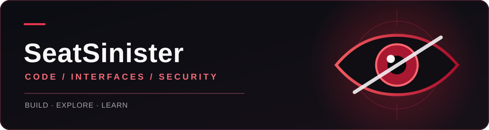

  

<h2 align="center">Привет, я SeatSinister 👋</h2>

  Делаю небольшие инструменты для Windows, изучаю интерфейсы и практическую безопасность.

  <code>C++</code> &nbsp;·&nbsp; <code>ImGui</code> &nbsp;·&nbsp; <code>PowerShell</code> &nbsp;·&nbsp; <code>Windows</code>

 

### Проекты

| Проект | Что внутри |
| :--- | :--- |
| [Windows Login Camera](https://github.com/SeatSinister/windows-login-camera) | Фото с веб-камеры при неверном входе в Windows. |
| [Standard ImGui Interface](https://github.com/SeatSinister/Standard-ImGui-interface) | Эксперименты с интерфейсом на ImGui. |
| [Simple Authorization ImGui](https://github.com/SeatSinister/Simple-Authorization-ImGui) | Пример экрана авторизации на ImGui. |
| [Anti CTF Tasks](https://github.com/SeatSinister/anti-ctf-tasks) | Задачи и заметки по CTF. |

Собираю идеи, пишу код и учусь на каждом проекте.

